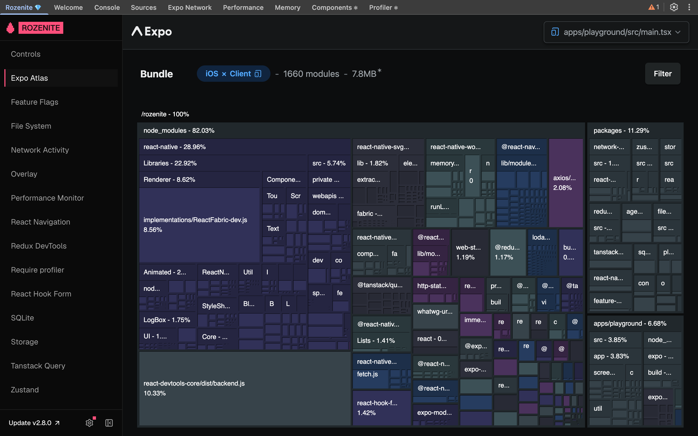

import PackageManagerTabs from '@/components/PackageManagerTabs.astro';



The Expo Atlas plugin brings [Expo Atlas](https://github.com/expo/expo-atlas) into React Native DevTools, so you can explore your Metro bundle, see what's taking up space, and trace dependencies without leaving DevTools.

## Installation

Make sure to go through the [Getting Started guide](/docs/getting-started) before installing the plugin.

<PackageManagerTabs command="install -D @rozenite/expo-atlas-plugin" />

Update your Metro configuration to enable the plugin:

```javascript title="metro.config.js"
const { withRozenite } = require('@rozenite/metro');
const { withRozeniteExpoAtlasPlugin } = require('@rozenite/expo-atlas-plugin');

const config = {
  // Your existing Metro configuration
};

module.exports = withRozenite(config, {
  // Your Rozenite configuration
  enhanceMetroConfig: (config) => withRozeniteExpoAtlasPlugin(config),
});
```

## Usage

Once configured, "Expo Atlas" appears in your React Native DevTools sidebar. From there you can:

- See total bundle size broken down by module and file type
- Inspect an individual module's size, source, and dependency chain
- Spot large dependencies, duplicated code, and unused code
- Analyze your development bundle live, or export and analyze a production bundle

**Next**: Explore other [Official Plugins](/docs/official-plugins/overview), or learn to build your own in the [Plugin Development guide](/docs/plugin-development/plugin-development).
