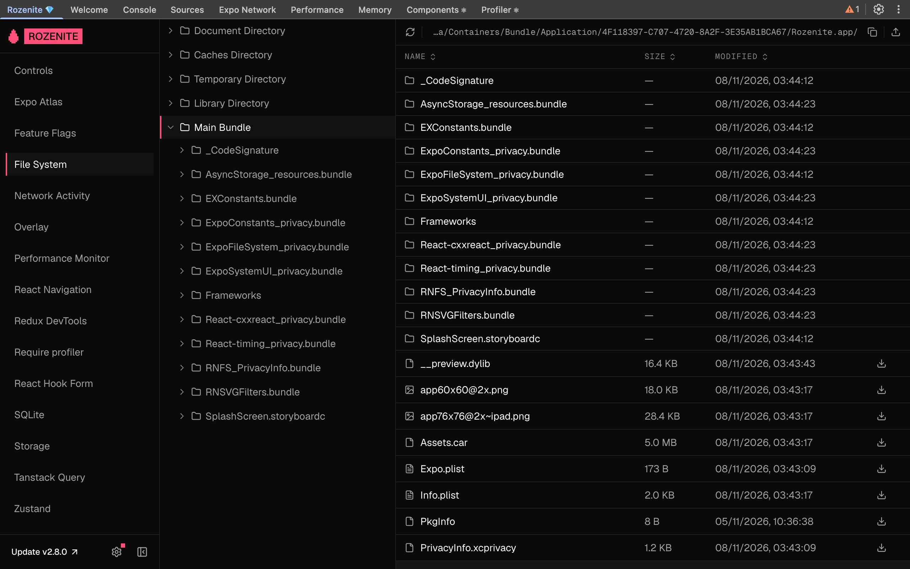

import PackageManagerTabs from '@/components/PackageManagerTabs.astro';



The File System plugin adds a file explorer to React Native DevTools, so you can browse your app's directories and preview files without leaving the DevTools window.

## Installation

Make sure to go through the [Getting Started guide](/docs/getting-started) before installing the plugin.

<PackageManagerTabs command="install -D @rozenite/file-system-plugin" />

Install whichever filesystem library your app already uses:

<PackageManagerTabs command="install -D expo-file-system" />

<PackageManagerTabs command="install -D @dr.pogodin/react-native-fs" />

## Usage

### With Expo FileSystem

```ts title="App.tsx"
import * as FileSystem from 'expo-file-system';
import {
  createExpoFileSystemAdapter,
  useFileSystemDevTools,
} from '@rozenite/file-system-plugin';

function App() {
  useFileSystemDevTools({
    adapter: createExpoFileSystemAdapter(FileSystem),
  });

  return <YourApp />;
}
```

### With RNFS

```ts title="App.tsx"
import RNFS from '@dr.pogodin/react-native-fs';
import {
  createRNFSAdapter,
  useFileSystemDevTools,
} from '@rozenite/file-system-plugin';

function App() {
  useFileSystemDevTools({
    adapter: createRNFSAdapter(RNFS),
  });

  return <YourApp />;
}
```

Once configured, the plugin appears in DevTools as "File System". You can jump between roots (document, cache, bundle, and others depending on your library), navigate folders, and preview text and image files inline. Files that can't be decoded as text fall back to a hex-style preview.

## File transfer

Importing and exporting files is off by default. Turn it on with `fileTransfer` when you want the panel to move files in or out of your app:

```ts title="App.tsx"
useFileSystemDevTools({
  adapter: createRNFSAdapter(RNFS),
  fileTransfer: {
    import: true,
    export: true,
  },
});
```

Imports keep the original filename and ask before overwriting an existing file.

If you also want coding agents to import or export files through Rozenite for Agents, opt in separately:

```ts title="App.tsx"
useFileSystemDevTools({
  adapter: createRNFSAdapter(RNFS),
  fileTransfer: {
    import: true,
    export: true,
    agent: { import: true, export: true },
  },
});
```

## Notes

:::caution[Provider required]
The plugin doesn't auto-detect a filesystem library — you always need to pass an `adapter`.
:::

:::note[Preview limits]
Previews are size-limited to keep DevTools responsive. Very large files may not preview, and very large directories are truncated in the listing.
:::

- `createExpoFileSystemAdapter` works with both the modern `expo-file-system` API and `expo-file-system/legacy`.
- `createRNFSAdapter` supports both `react-native-fs` and `@dr.pogodin/react-native-fs`.
- File transfer handles one file at a time, within visible filesystem roots.

## Agent Tools (LLM Integration)

When active, this plugin registers agent tools under the `@rozenite/file-system-plugin` domain: `list-roots`, `list-entries`, `read-entry`, `read-text-file`, `read-image-file`, plus `export-file` / `import-file` when the matching `fileTransfer.agent` option is enabled.

Reads are bounded for agents: `read-text-file` returns 16 KB at a time (use `offset` and `maxBytes` for more), `read-image-file` returns metadata unless `inline: true` asks for the image, and `export-file` refuses files over 1 MB unless `maxBytes` allows them.

**Next**: Learn about [Plugin Development](/docs/plugin-development/plugin-development), or explore other [Official Plugins](/docs/official-plugins/overview).
