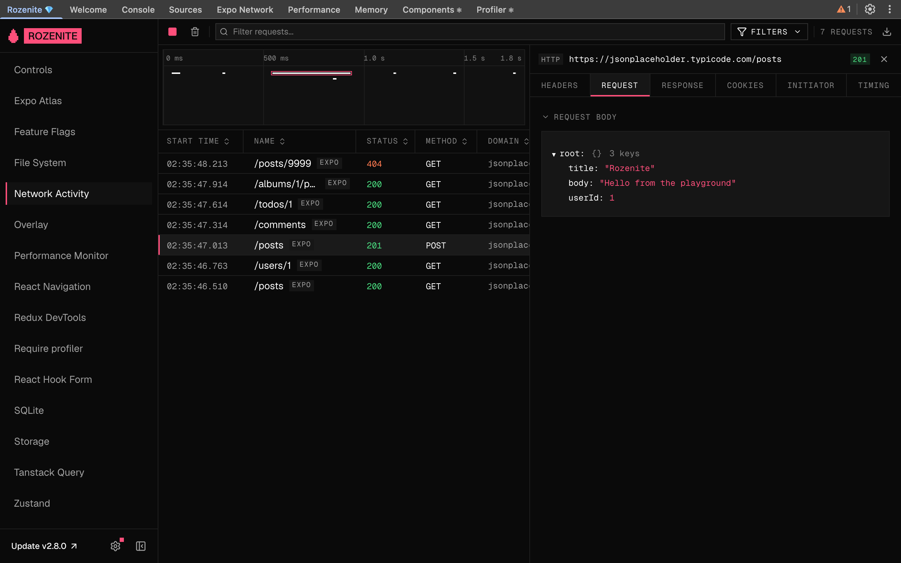

import PackageManagerTabs from '@/components/PackageManagerTabs.astro';



The Network Activity plugin brings a Chrome-DevTools-style network inspector into React Native DevTools: every HTTP/HTTPS request, WebSocket connection, and Server-Sent Event your app makes, in real time.

:::caution[JavaScript thread only]
Built-in React Native inspectors only see traffic from the JavaScript thread. If your app uses `react-native-nitro-fetch`, install it alongside this plugin and its traffic shows up in the same panel. Other native networking stacks won't appear automatically.
:::

## Installation

Make sure to go through the [Getting Started guide](/docs/getting-started) before installing the plugin.

<PackageManagerTabs command="install -D @rozenite/network-activity-plugin" />

```typescript title="App.tsx"
import { useNetworkActivityDevTools } from '@rozenite/network-activity-plugin';

function App() {
  useNetworkActivityDevTools();

  return <YourApp />;
}
```

To also capture requests made before your app finishes initializing, add this to your entry point:

```typescript title="index.js"
import { withOnBootNetworkActivityRecording } from '@rozenite/network-activity-plugin';

withOnBootNetworkActivityRecording();
```

If your app uses nitro networking, install it too, and its HTTP and WebSocket traffic merges into the same panel automatically:

```bash
npm install react-native-nitro-fetch
```

## Usage

Once configured, "Network Activity" appears in your React Native DevTools sidebar. The request list shows method, status, timing, and a `Built-in` / `Nitro` badge for where each request came from. Click any request for full details: headers, query parameters, and request/response bodies.

### Viewing responses

The response body view adapts to the content type, with a Preview / Raw toggle when both are useful:

- **Images and SVGs** render inline; other binary formats (PDF, zip, audio, video, fonts) show a byte-level view instead, since there's nothing to preview.
- **JSON and XML** render as a collapsible, copyable tree, with the raw body pretty-printed in the Raw tab.
- **HTML** renders in a sandboxed preview that can't make outbound requests, with the source available in Raw.
- **Text formats** (plain text, CSS, JS) render as monospace text.
- Every binary response has a **Download** button; very large or empty responses show a placeholder instead of a preview.

## Configuration

By default all traffic types are monitored. Disable ones you don't need — useful when a type is noisy or expensive to capture:

```typescript title="App.tsx"
useNetworkActivityDevTools({
  inspectors: {
    http: true,
    websocket: false,
    sse: false, // requires http to be enabled
  },
});
```

**Next**: Learn about [Plugin Development](/docs/plugin-development/plugin-development), or explore other [Official Plugins](/docs/official-plugins/overview).
