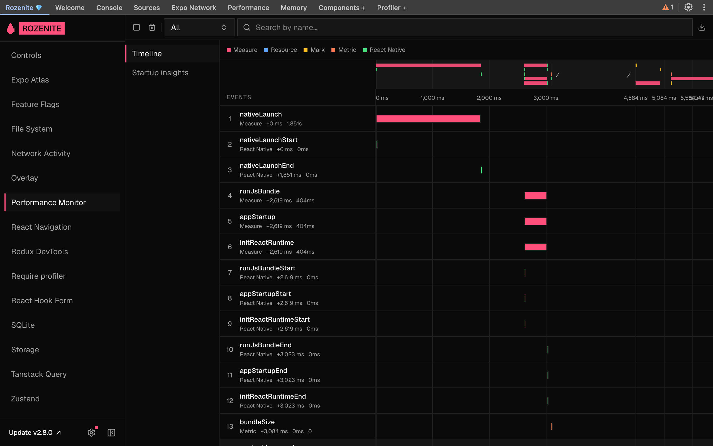

import PackageManagerTabs from '@/components/PackageManagerTabs.astro';



The Performance Monitor plugin shows startup timing and performance marks in React Native DevTools. It's built on the [`react-native-performance`](https://github.com/oblador/react-native-performance) library, so anything you already mark or measure with it shows up automatically.

## Installation

Make sure to go through the [Getting Started guide](/docs/getting-started) before installing the plugin.

<PackageManagerTabs command="install -D @rozenite/performance-monitor-plugin react-native-performance" />

```typescript title="App.tsx"
import { usePerformanceMonitorDevTools } from '@rozenite/performance-monitor-plugin';

function App() {
  usePerformanceMonitorDevTools();

  return <YourApp />;
}
```

## Web (React Native for Web)

With [Rozenite for Web](/docs/targets/rozenite-for-web), this plugin is also available when debugging your React Native web app.

## Usage

Once configured, "Performance Monitor" appears in your React Native DevTools sidebar.

### Startup

The first tab you see breaks down your app's launch time: native initialization, JS bundle parse/execute, and the first React render. It populates automatically as soon as you start a session — no instrumentation needed. A phase shows "In progress…" while it's still running, or "—" if your app's architecture doesn't report it.

### Custom marks and measures

Add your own marks, measures, and metrics from anywhere in your app using `react-native-performance` directly — they show up in the panel in real time:

```typescript
import performance from 'react-native-performance';

performance.mark('app-start');
performance.mark('data-loaded');
performance.measure('app-initialization', 'app-start', 'data-loaded');
performance.metric('custom-metric', 42, { detail: 'Additional info' });
```

- **Marks** are named points in time — e.g. `user-login-complete`.
- **Measures** are durations between two marks — e.g. the time between `login-start` and `login-end`.
- **Metrics** are arbitrary values you want to track, e.g. `performance.metric('memory-usage', 1024, { unit: 'MB' })`.

### Sessions

Start and stop a monitoring session from the panel, and export what it captured for further analysis.

**Next**: Learn about [Plugin Development](/docs/plugin-development/plugin-development), or explore other [Official Plugins](/docs/official-plugins/overview).
