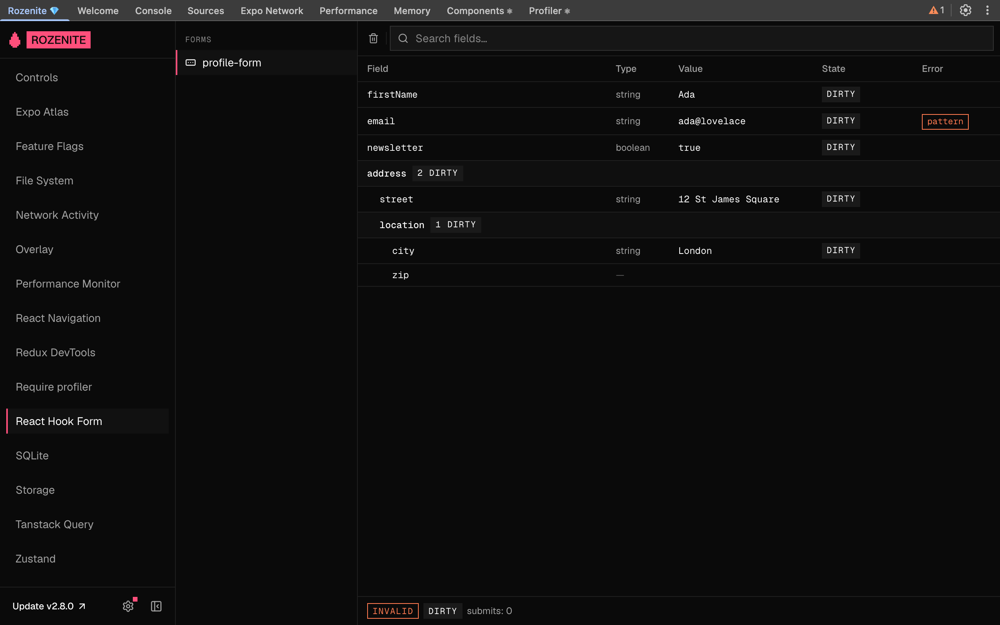

import PackageManagerTabs from '@/components/PackageManagerTabs.astro';



The React Hook Form plugin lets you inspect your forms in real time from React Native DevTools. For every mounted form you can see field values, validation errors, dirty and touched states, native input types, and overall form status — without adding any logging or breakpoints.

## Installation

Make sure to go through the [Getting Started guide](/docs/getting-started) before installing the plugin.

<PackageManagerTabs command="install -D @rozenite/rhf-plugin" />

## Setup

Call `useRozeniteRHFPlugin` inside any component that has access to a `react-hook-form` `control` object:

```typescript title="MyForm.tsx"
import { useForm } from 'react-hook-form';
import { useRozeniteRHFPlugin } from '@rozenite/rhf-plugin';

function MyForm() {
  const { control, handleSubmit } = useForm();
  useRozeniteRHFPlugin({ control });

  return (
    // your form JSX
  );
}
```

That's all. The panel appears automatically in React Native DevTools under **React Hook Form**.

## Multiple Forms

Each `useRozeniteRHFPlugin` call registers an independent entry in the panel. By default the panel uses React's internal ID to label each form. Pass an explicit `id` to make the label readable:

```typescript
useRozeniteRHFPlugin({ control, id: 'checkout-form' });
```

When a form unmounts it stays visible in the panel marked as **disconnected**, so you can still inspect its last snapshot.

## What the Panel Shows

| Column    | Description                                                                  |
| --------- | ---------------------------------------------------------------------------- |
| **Field** | Registered field name. Nested objects are grouped into collapsible sections. |
| **Type**  | Native input type (`text`, `email`, …) when available.                       |
| **Value** | Current field value.                                                         |
| **State** | `dirty` and `touched` badges.                                                |
| **Error** | Validation error type and message.                                           |

The header bar shows global form status: `valid`, `invalid`, `dirty`, `submitting`, `submitted`, `submitSuccessful`, `validating`, and the submit count.

Use the search box to filter fields by name.

## Peer Dependencies

This plugin requires `react-hook-form` v7:

```json
"react-hook-form": "^7.33.1"
```
