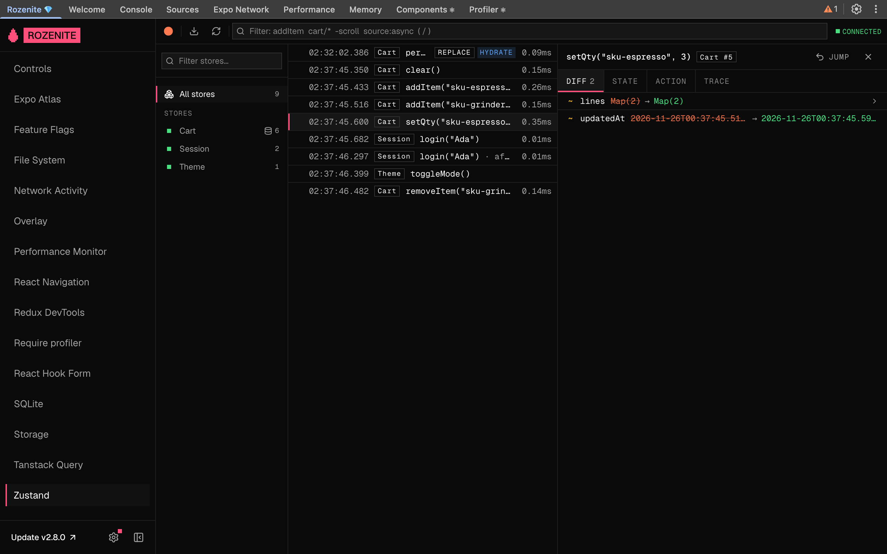

import PackageManagerTabs from '@/components/PackageManagerTabs.astro';



The Zustand plugin records every change to your Zustand stores and shows it in a **Zustand** panel in React Native DevTools:

- a timeline of named actions with their arguments, taken from your store's functions with no extra code
- a diff for each change, with the call site symbolicated through Metro
- time travel to any state the app still holds, and export of the history as JSON
- live editing, and calling store actions with JSON arguments
- the status of the `persist` middleware

Every store appears in one place, so you can follow one action across stores.

## Installation

Make sure to go through the [Getting Started guide](/docs/getting-started) before installing the plugin.

<PackageManagerTabs command="install -D @rozenite/zustand-plugin" />

## Setup

Wrap your store's initializer with `rozenite()` and give it a stable `name`. Place `rozenite()` **outermost** so it sees `persist` hydration:

```typescript title="cartStore.ts"
import { create } from 'zustand';
import { persist } from 'zustand/middleware';
import { rozenite } from '@rozenite/zustand-plugin';

export const useCartStore = create<CartState>()(
  rozenite(
    persist(
      (set) => ({
        items: [],
        addItem: (item: Item) => set((state) => ({ items: [...state.items, item] })),
        checkout: async () => {
          set({ status: 'pending' });
          await api.checkout();
          set({ status: 'paid', items: [] });
        },
      }),
      { name: 'cart' },
    ),
    { name: 'Cart' },
  ),
);
```

Calling `addItem(item)` shows up as `addItem({…})`. Both `set` calls in `checkout` are named `checkout()`, and the one after the `await` is marked `· after await`. When several async actions of the store are in flight at once, such a `set` stays anonymous rather than being guessed. A third `set` argument still names a change explicitly, just like with `devtools()`.

`rozenite()` takes these options:

- `name` (required): the store's name and stable id
- `enabled`: defaults to `true` in development
- `maxAge`: transitions kept on the app (default `50`), replayed when the panel connects; only their states can be jumped to
- `trace`: capture a stack for every change, symbolicated through Metro in the panel
- `stateSanitizer`: strip secrets or huge values from the state before it leaves the app

Large arrays, objects and strings load lazily in the panel. When one snapshot or transition still encodes to more than 50,000 values, usually because an object is shared between many places in the state, the store gets a warning.

## Stores without the middleware

For a store you can't or don't want to wrap, such as one from a library, register it with `observeStore()` once, next to the store:

```typescript
import { observeStore } from '@rozenite/zustand-plugin';

observeStore(useLegacyStore, { name: 'Legacy' });
```

It takes the same options as `rozenite()` and returns a function that stops observing. The store gets the timeline, diffs, time travel, editing, callable actions, `persist` status and agent tools, but not action names: without the middleware it cannot see which action made a change, so changes show as `observed`. Changes made from the panel or by an agent are still named.

## Time travel

Jump from a transition's detail view, with <kbd>J</kbd> on a selected row, or with the scrubber below the timeline. The app restores its own copy of that state, so values hidden by `stateSanitizer` or never loaded in the panel come back intact, and the store's functions stay the live ones. The app keeps the last `maxAge` states; older entries stay in the panel but cannot be jumped to.

On a store that uses `persist`, the restored state is written to storage like any other change. The Persist tab shows the storage key, version and hydration status, and can rehydrate or clear storage.

## Rozenite for Agents

```typescript
import { useZustandAgentTools } from '@rozenite/zustand-plugin';

useZustandAgentTools();
```

With this hook, agents can list stores, read state and history, call actions, set values, time travel and pause recording.

## Production

`rozenite()`, `observeStore()` and the agent hook compile to pass-throughs in production builds.
